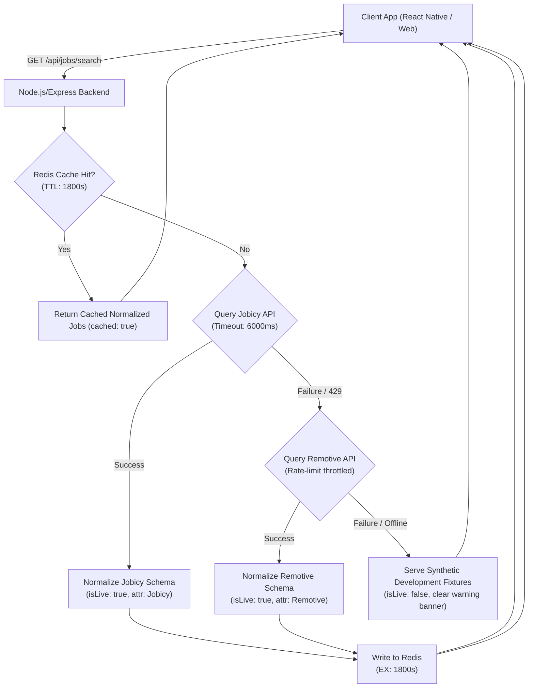

# Free Job Listings Provider Evaluation & Terms of Service Compliance

This document provides a comparative analysis and compliance audit of free external job-listing providers evaluated for the **Campus Career & Learning Intelligence Platform**.

---

## 1. Executive Summary & Provider Selection

| Evaluation Criterion | **Jobicy Remote Jobs API** (Selected Primary) | **Remotive Public API** (Selected Secondary) | **Scraping (LinkedIn / Naukri)** |
| :--- | :--- | :--- | :--- |
| **Authentication** | **No API key required** for public endpoints. | **No API key required** for public endpoints. | Prohibited / High Risk. |
| **Status in Platform** | **Primary Live Provider** | **Secondary Live Provider** | **Strictly Forbidden** |
| **Free Tier Usability** | Generous, up to 100–200 listings/query. | Strict hard throttle (max 2 req/min). | High risk of IP banning & legal violation. |
| **Freshness / Latency** | **Real-time** fresh listings. | **24-hour publication delay** on free tier. | Stale / fragile DOM structures. |
| **Geographic Coverage** | Global remote (`usa`, `uk`, `apac`, `latam`, `canada`, `europe`, `anywhere`). | Global remote (with `candidate_required_location` string). | Regional (US/India), but gated by logins. |
| **Rate Limit** | Fair-use policy (~1 req/sec). | **2 requests / minute** (enforced by Cloudflare). | Blocked / CAPTCHA challenges. |
| **Salary Data** | Structured (`annualSalaryMin`, `annualSalaryMax`, `salaryCurrency`). | Unstructured string (e.g. `"$120,000 - $140,000"`). | Often behind login wall. |
| **Attribution Requirement** | Attribution to Jobicy with listing URL. | Mandatory attribution + link to Remotive. Strictly forbids republication to third-party aggregators. | Breach of Terms of Service. |
| **Commercial Upgrades** | Direct ATS links via optional API key. | Private commercial API tier via contact. | Enterprise Recruiter licenses ($$$). |

### Selection Decision
1. **Primary Provider: Jobicy (`JobicyJobAdapter`)**
   - Clean, structured JSON with numeric salary ranges, categorized industries, and geographic tags.
   - Real-time updates without artificial time delays.
   - Zero-credential public endpoint protects mobile apps and eliminates key leakage risks.
2. **Secondary / Failover Provider: Remotive (`RemotiveJobAdapter`)**
   - Automatically used as a failover if Jobicy suffers temporary downtime.
   - Guarded by built-in rate-limit throttling in our adapter to avoid triggering Remotive's 2 req/min block.
3. **Synthetic Development Fixtures (`MockJobFixtureAdapter`)**
   - High-fidelity offline fallback when the backend operates without internet connectivity or both upstream APIs are down.
   - **Crucial Rule**: Every fixture is permanently marked with `isLive: false` and `sourceName: "Development Fixture (Offline Simulation)"` to avoid misleading students.

---

## 2. In-Depth Provider Breakdown

### Provider A: Jobicy Remote Jobs API
- **Endpoint URL**: `https://jobicy.com/api/v2/remote-jobs`
- **Authentication**: None required for public endpoint. Optional commercial token if direct ATS application URLs are needed.
- **Geographic Coverage & Filtering**:
  - Global remote jobs.
  - Parameter `geo`: supports `usa`, `uk`, `canada`, `europe`, `apac`, `latam`, `anywhere`.
- **Query Parameters**:
  - `count`: integer (1–100, maximum 200).
  - `geo`: regional location filter.
  - `industry`: job sector (`engineering`, `dev`, `data`, `design`, `business`, `marketing`).
  - `tag`: search tag or skill keyword (e.g., `react`, `python`, `devops`).
- **Data Freshness**:
  - Real-time updates; listings refreshed throughout the day.
  - Status checking endpoint: `https://jobicy.com/api/v2/remote-jobs/status?ids=1,2,3`.
- **Attribution & Usage Terms**:
  - Requires public attribution acknowledging Jobicy as the data source and linking to the Jobicy listing URL.
  - Public tier forbids aggressive automated bulk extraction.
- **Backend Credentials**:
  - Kept strictly on the backend. No tokens or URLs with credentials are ever included in the React Native or web frontend client code.

---

### Provider B: Remotive Public API
- **Endpoint URL**: `https://remotive.com/api/remote-jobs`
- **Authentication**: None required for public tier.
- **Query Limits & Rate Limits**:
  - **Hard Limit**: Maximum **2 requests per minute**. Violations return `HTTP 429 Too Many Requests`.
  - **Recommended Fetching Rate**: 4 times per day.
- **Data Freshness**:
  - Public API listings have an **enforced 24-hour latency delay**.
- **Geographic Restrictions**:
  - Remote-first listings. Country eligibility is specified as freeform text (e.g., `"USA Only"`, `"Europe"`, `"Worldwide"`).
- **Attribution & Terms of Use**:
  - **Mandatory Attribution**: Must display *"Powered by Remotive"* and link back to the listing on `remotive.com`.
  - **Prohibited Republication**: Strictly prohibited from republishing Remotive jobs into competing job boards or aggregators (e.g., Google Jobs, Jooble, LinkedIn).
  - **Prohibited Scraping**: Does not permit automated bulk scraping of candidate emails or user data.

---

### Provider C: Scraping LinkedIn, Naukri, Indeed (Prohibited)
- **LinkedIn User Agreement (Section 8.2)**:
  - Expressly prohibits scraping, crawling, spidering, or utilizing automated scripts to copy profiles, company pages, or job listings without explicit prior written consent.
  - Following *hiQ Labs v. LinkedIn*, LinkedIn maintains strict technical countermeasures (anti-bot fingerprinting, IP blacklisting, CAPTCHA rate limits, and legal cease-and-desist enforcement).
- **Naukri Terms of Use (Info Edge India Ltd.)**:
  - Section 4 explicitly bans data mining, scraping, and reverse-engineering of job seeker or employer content. Automated extraction triggers automated legal notices and permanent IP subnetwork bans.
- **Decision**:
  - In strict compliance with user instructions (*"Do not scrape LinkedIn, Naukri or other job websites without confirming that the method is permitted"*), no web scraping is implemented. All job data is sourced through legitimate, authorized public APIs.

---

## 3. Architecture & Resiliency Implementation

### Key Technical Guarantees
1. **Normalized Schema Contract**:
   Every job record exposes:
   - `id`: composite ID (`jobicy_{id}`, `remotive_{id}`, `fixture_{id}`)
   - `provider`: source identifier
   - `title`, `company`, `description`, `originalUrl`
   - `workArrangement`: `'remote'` | `'hybrid'` | `'on-site'`
   - `employmentType`: `'full-time'` | `'part-time'` | `'contract'` | `'internship'`
   - `salary`: structured object or `null` (never fabricated!)
   - `retrievedAt`: ISO retrieval timestamp
   - `isLive`: `true` for live APIs, `false` for development fixtures
   - `attribution`: provider text and link
2. **Provider-Adapter Extensibility**:
   Additional providers (e.g., Adzuna, USAJobs, GitHub Jobs successors) can be plugged in by implementing `IJobProviderAdapter` without altering existing client-facing routes or mobile screens.
3. **Graceful Cache Degradation**:
   Redis operations run inside a safe execution wrapper (`safeExec`). If Redis is temporarily stopped, queries directly hit adapters or in-memory fallback cache without throwing 500 errors.
4. **Backend-Only Credentials**:
   Zero credentials or provider keys are bundled into frontend or mobile assets.
